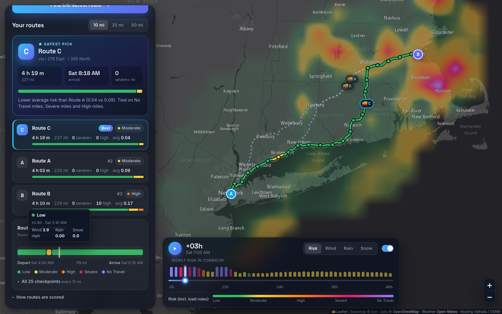

# Stormline — Weather-Aware Truck Routing

React + Django app that gives a truck driver **3 route options**, checks the forecast at each
checkpoint **at the time the truck will be there**, scores the weather with the assessment's
risk and load rules, and **recommends the safest route**. A corridor **weather heatmap with a
0–48 h slider** shows how conditions change during the trip.



**Live demo:** _add the hosted URL here_ · **Walkthrough:** _add the Loom link here_

---

## What it does

| Requirement | Where / how |
|---|---|
| Origin, destination, departure, load | Form with place autocomplete (Photon/OSM); departure in the browser's timezone, sent as UTC ISO-8601 |
| 3 route options from a routing API | Valhalla **truck** profile using gross weight (load + 35,000 lb tare); gaps filled as described below; OSRM fallback |
| Weather every 10 / 25 / 50 mi at the truck's ETA | All three spacings are computed in one request, so the toggle switches instantly |
| Risk from the rules table + load rules | [`backend/planner/risk.py`](backend/planner/risk.py), tested at every boundary |
| Recommend the best route | Lexicographic ranking from the brief, with a one-line explanation of what decided it |
| Map: routes, checkpoints, risk, ETAs, summaries | Selected route coloured by risk; checkpoint tooltips; route cards; checkpoint table; rest stops; truck positions |
| Heatmap along the corridor, 0–48 h slider | Canvas overlay with spatial and temporal interpolation; scrubbing and playback run at 60 fps |

## How the logic works

### 1. Routes
* **Primary:** [Valhalla](https://valhalla.github.io/valhalla/) public server, `truck` costing, with the
  truck's gross weight, so weight-restricted roads and truck speeds are respected.
* Routing APIs often return fewer than 3 alternatives, so the gaps are filled in this order:
  1. Valhalla's own alternates.
  2. OSRM's alternatives are used as *guides*. Take the middle of the stretch that differs
     from routes already chosen, and ask Valhalla for a truck route through that point
     **with a heading**, so the truck drives straight through it and doesn't U-turn.
  3. Points offset to either side of the origin–destination line, then a small exclusion zone
     on the fastest route.

  A candidate is kept only if it overlaps every chosen route by less than 80% and takes no
  more than 1.6× the fastest drive time.
* **Fallback:** the public Valhalla server only accepts trips up to ~930 mi straight-line. Longer
  trips (e.g. NYC → LA) use OSRM. That is a car profile, so a **65 mph truck speed cap** is applied
  per segment and the UI shows a notice.

### 2. Checkpoints and ETAs
* Checkpoints sit at mile 0, *I*, 2*I*, … and at the destination. Each checkpoint stands for the
  road **halfway to its neighbours**, so its "covered miles" sum to the route length and
  *Severe miles* are real road miles.
* ETA = departure + driving time to that point (from the routing API's per-segment times)
  + any **FMCSA hours-of-service stops** taken before it: a 30-min break after 8 h of driving
  and a 10-h rest after 11 h. This is on by default because it changes ETAs a lot on
  multi-day trips. The 14-hour duty window is not modelled.

### 3. Weather
* [Open-Meteo](https://open-meteo.com/) hourly forecast, batched (100 locations per call, run in
  parallel). Units are mph and in/hr. Rain = `rain + showers`; snow = `snowfall` (inches of snow).
* **Time alignment:** wind is instantaneous, so the **nearest hour** is used. Precipitation is the
  accumulation over the hour that *ends* at its timestamp, so the hour **containing** the ETA is used.
* Coordinates are snapped to 0.02° (~1.4 mi, finer than the ~3 km model grid) so routes that share
  a highway share fetches. Results are cached for 30 min.
* **Free-tier budget.** Open-Meteo's free API counts every location as one call and allows 600 per
  minute. A plan uses at most 350 locations and a heatmap at most 220, so one trip fits in one minute.
  On very long trips (e.g. NYC → LA, ~8,600 route-miles across 3 routes), nearby checkpoints share a
  coarser forecast cell (up to ~35 mi). Every checkpoint is still scored at its own ETA, and the UI shows
  the cell size. Setting `OPEN_METEO_API_KEY` (paid) and a higher `PLAN_LOCATION_BUDGET` restores the
  fine grid. Hitting the limit gives a clear "wait a minute" message.
* ETAs beyond the forecast horizon are marked **No forecast**. They are excluded from the scores
  and the UI says so.

### 4. Risk
Each checkpoint gets the **worst** of its wind, rain and snow levels.

| Condition | Low | Moderate | High | Severe | No Travel |
|---|---|---|---|---|---|
| Wind (mph) | < 25 | 25–34 | 35–44 | 45–54 | ≥ 55 |
| Rain (in/hr) | < 0.10 | 0.10–0.25 | 0.25–0.50 | 0.50–1.00 | > 1.00 |
| Snow (in/hr) | < 0.5 | 0.5–1.0 | 1.0–2.0 | 2.0–3.0 | > 3.0 |

Load rules (wind only): ≥ 55 mph → No Travel for any load; 45–54 mph and > 30,000 lb → No Travel;
35–44 mph and > 40,000 lb → Severe.

**Boundary choice.** The table's ranges share endpoints (0.25 appears in both Moderate and High).
Bands here are **lower-inclusive**, so a value exactly on a boundary goes to the more cautious band:
25 mph is Moderate and 0.25 in/hr is High. The top of Severe is inclusive because the table says
No Travel is strictly "> 1.00" / "> 3.0". Wind is **sustained** 10 m wind. Gusts are shown, but the
table doesn't say to use them.

### 5. Recommendation
Routes are compared on each criterion in order; a later criterion only matters when every
earlier one is tied:

0. fewest **No Travel** miles (implied: No Travel is worse than Severe)
1. fewest **Severe** miles
2. fewest **High** miles
3. lowest **average risk**: mileage-weighted mean level (Low 0, Moderate 1, High 2, Severe 3, No Travel 4)
4. shortest **travel time**, including rest stops

Miles are compared at 0.1 mi and average risk at 0.01, so float noise can't settle a tie. The UI
shows the deciding criterion, e.g. *"Fewer Severe miles than Route B (0 vs 50 mi)"*. It warns when
even the best route has Severe or No Travel miles.

### 6. Heatmap
* The backend builds a grid that is **uniform in Web Mercator** over the routes, keeps only the cells
  within 45 mi of a route (the corridor), and fetches hourly data for 0–48 h after departure.
  Cell spacing adapts to keep the grid at ≤ 320 points, inside the free API's rate limits.
* The frontend draws it on a small canvas that Leaflet stretches over the grid bounds. Each pixel
  is a **bilinear blend** of its four neighbouring cells, and the corridor mask is blended the
  same way so its edge fades out. Fractional slider positions **blend between forecast hours**,
  so playback is smooth. A frame is ~25k multiply-adds and one `putImageData`, with no requests,
  re-renders or image decoding.
* Layers: **Risk** (uses the load rules) or raw **Wind / Rain / Snow**, all on the same colour
  scale, so a colour means the same risk band in every layer.
* The slider also moves a **truck marker** along each route to where it will be at that time,
  holding still during rest stops.

## Architecture

```
frontend/ (React 19 + TypeScript + Vite + react-leaflet)
  src/App.tsx                     state, data flow
  src/components/MapView.tsx      routes, risk segments, checkpoints, stops, trucks
  src/components/HeatmapLayer.tsx Leaflet overlay hosting the heatmap canvas
  src/lib/heatmapRenderer.ts      precomputed bilinear weights, per-frame paint
  src/lib/geometry.ts             mile ↔ position, risk segments, truck progress
backend/ (Django 6, no database)
  planner/routing.py     Valhalla/OSRM clients, 3 distinct alternatives
  planner/timeline.py    drive time → wall-clock ETA, hours-of-service stops
  planner/weather.py     Open-Meteo batching, caching, hour alignment
  planner/risk.py        risk table + load rules (+ continuous score for the heatmap)
  planner/recommend.py   summaries, ranking, explanation
  planner/services.py    orchestration: routes → checkpoints → weather → risk → ranking
  planner/heatmap.py     corridor grid + 0–48 h series
  planner/views.py       JSON API + input validation
api/index.py             Vercel serverless entry point
```

The browser makes two requests: `/api/plan` (routes and scores) and then `/api/heatmap`.
Routes appear as soon as the first returns while the heatmap loads in the background.

### API

```http
POST /api/plan
{ "origin": {"lat": 41.88, "lon": -87.63}, "destination": "Denver, CO",
  "departure": "2026-11-07T15:00:00Z", "load_lbs": 42000, "include_hos": true }
```
Returns `routes[]`, each with geometry, mileposts, distance, drive and travel time, arrival,
rest `stops`, `checkpoints` and `summary` keyed by `"10" | "25" | "50"`, plus a
`recommendation` per spacing (`route_id`, `ranking`, `reason`, `warning`).

```http
POST /api/heatmap   { "routes": [[[lat, lon], …], …], "departure": "…", "load_lbs": 42000 }
GET  /api/geocode?q=Denver
```
Invalid input returns `400 {"error": "…"}`; upstream failures return `502`.

## Run locally

```bash
# backend (Python 3.12+)
python -m venv .venv && .venv/bin/pip install -r backend/requirements.txt
cd backend && ../.venv/bin/python manage.py runserver        # :8000

# frontend (Node 20+), in another shell
cd frontend && npm install && npm run dev                     # :5173, proxies /api to :8000
```
No API keys are needed: every service is free and keyless.

### Tests
```bash
cd backend && ../.venv/bin/python manage.py test planner   # 65 tests: risk table, load rules,
                                                           # HOS/ETA, checkpoints, ranking, API
cd frontend && npm test && npm run lint                    # geometry, truck progress, colour scale
```
[`planner/tests/test_assessment_spec.py`](backend/planner/tests/test_assessment_spec.py) follows the brief
section by section (risk table, load rules, ranking order, 3 routes, 10/25/50 mi sampling at the ETA,
0–48 h heatmap). Manual UI checks are in [`docs/TEST_CASES.md`](docs/TEST_CASES.md).

## Deploy
* **Vercel:** import the repo and deploy; `vercel.json` sets everything up. Vite builds the
  static site and `api/index.py` serves `/api/*` as a Python function (60 s max duration).
* **Any container host (Render, Fly, Railway):** `docker build -t truck-routing . && docker run -p 8000:8000 truck-routing`.
  gunicorn serves both the API and the built frontend.

## Limitations and next steps
* The public demo servers (Valhalla, OSRM, Photon, Open-Meteo) have fair-use limits. For production,
  self-host Valhalla (which also removes the ~930 mi cap) and use a paid Open-Meteo key. The base URLs
  are environment variables.
* The cache is per-process (`LocMemCache`); use Redis when running several instances.
* The HOS model is simplified (no 14-hour window or 70-hour/8-day cycle). Mountain passes, chain laws
  and road closures are not considered; only the brief's three variables are scored.

*Data: © OpenStreetMap contributors (map tiles, Valhalla, OSRM, Photon); weather by Open-Meteo.com (CC BY 4.0).*
